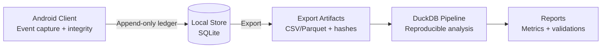

# Alex Maina

## Deterministic data systems (verifiable, reproducible, predictable)

I build systems where:
- **data is verifiable** (integrity checks + invariants)
- **pipelines are reproducible** (same inputs → same outputs)
- **behavior is deterministic** across environments

---

## Featured: Trace — Deterministic Behavioral Event Ledger

A mobile-first event ledger built to guarantee:
- **lossless recovery** after uninstall/reinstall
- **byte-identical reconstruction** of the ledger
- **reproducible exports** for external analysis (DuckDB)

### System diagram

### Determinism contract (what must always be true)
| Guarantee | What it means |
|---|---|
| Append-only ledger | No mutation of historical events |
| Schema + invariants | Invalid events never enter the ledger |
| Content-addressed exports | Artifacts can be verified via hashes |
| Reproducible pipeline | Re-running produces identical results |

> Implementation repos are currently **private** (Trace Lab / Android / Backend). I can share a walkthrough on request.

---

## Proof-style artifacts (what I publish even while code is private)
- A **sample anonymized dataset** (small, synthetic)
- Export **hash manifest** (to verify artifacts)
- A DuckDB **one-command reproduction** script
- A short **pipeline report** (row counts, invariants, checks)

---

## Stack
**Languages:** Python, Kotlin, Java, SQL  
**Data:** DuckDB, SQLite  
**Backend:** Flask APIs

---

## Current direction
Data Engineering • MLOps systems • AI-integrated pipelines

---

## Philosophy
> If a system can’t be verified, it can’t be trusted.

---

## Contact
LinkedIn: https://www.linkedin.com/in/alex-kinyua-40627b270/
